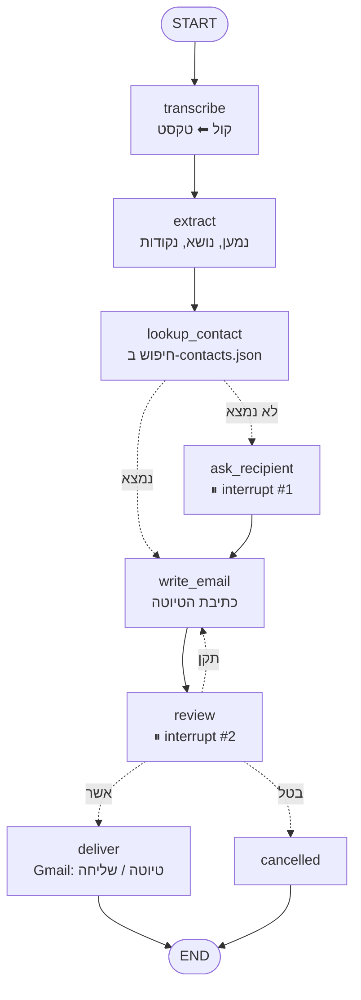
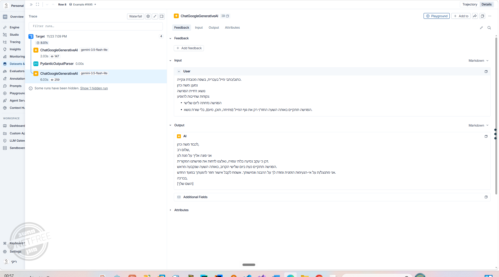
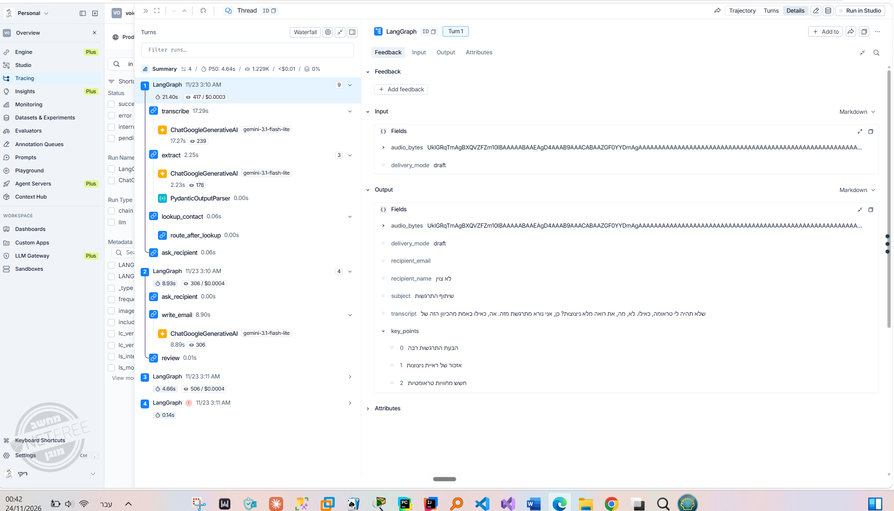

# ✉️ סוכן מייל קולי (LangChain + LangGraph + Gemini + LangSmith)

סוכן שמקבל **בקשה קולית** ("תכתבי למשה שהפגישה נדחתה ליום שלישי"),
מתמלל אותה, מבין למי לשלוח ומה לכתוב, כותב טיוטה,
**עוצר ומחכה לאישור שלך**, ובסוף שומר טיוטה או שולח ב-Gmail.

הכל **חינמי**: Gemini (תוכנית חינמית), LangSmith (תוכנית Developer), ‏Gmail API.

---

## עמידה בדרישות התרגיל

| דרישה | איפה זה בפרויקט |
|---|---|
| שימוש בספריית LangGraph | `graph.py`: ‏`StateGraph` עם 8 צמתים |
| לולאה או ענף מותנה | שני ענפים מותנים: `route_after_lookup` (נמצא נמען?) ו-`route_after_review` (אשר / תקן / בטל). **לולאה**: ‏`review` ⬅ `write_email` ⬅ `review`, עד 3 סבבי תיקון |
| interrupt ו-human-in-the-loop | שני interrupts: `ask_recipient` (בחירת נמען כשלא נמצא) ו-`review` (אישור הטיוטה) |
| דאטהסט והערכה ב-LangSmith, לפני ואחרי | `create_dataset.py` + `run_experiment.py`: ‏10 דוגמאות, 3 מעריכים, ניסויי `before` ו-`after` |
| README עם צילומי trace ותובנה | הקובץ הזה 🙂 |

---

## מבנה הגרף



---

## הקבצים

| קובץ | תפקיד |
|---|---|
| `state.py` | ה-State: "הזיכרון" שעובר בין הצמתים |
| `llm.py` | יצירת מודל Gemini פעם אחת (שם המודל נקרא מ-`.env`) |
| `nodes.py` | הצמתים: תמלול, חילוץ (structured output), חיפוש איש קשר, כתיבה |
| `graph.py` | חיבור הגרף: קשתות, ענפים מותנים, interrupts, checkpointer |
| `app.py` | ממשק Streamlit: הקלטה (`st.audio_input`), מסכי האישור והתיקון |
| `gmail_client.py` | טיוטה / שליחה ב-Gmail, כולל מצב הדמיה (`DRY_RUN`) |
| `contacts.json` | אנשי קשר עם כינויים |
| `dataset_examples.json` | 10 בקשות בסגנון דיבור לדאטהסט |
| `create_dataset.py` | העלאת הדאטהסט ל-LangSmith |
| `run_experiment.py` | הרצת ניסוי עם 3 מעריכים |

---

## התקנה והרצה

```
python -m venv .venv
.venv\Scripts\Activate.ps1
pip install -r requirements.txt
```

1. מעתיקים את `.env.example` ל-`.env` וממלאים: מפתח Gemini, מפתח LangSmith, שם מודל.
2. לשליחה אמיתית: `credentials.json` מ-Google Cloud (Desktop client) ו-`DRY_RUN=false`.
3. מריצים:
```
streamlit run app.py
```

ניסויים:
```
python create_dataset.py
python run_experiment.py before
python run_experiment.py after
```

---

## הערכה ב-LangSmith

**הדאטהסט** `voice-email-requests`: ‏10 בקשות כתובות בסגנון דיבור, כולל מקרים קשים:
היסוס ("אממ... ש..."), תיקון באמצע ("לשושנה, לא רגע, לשושי"), כינוי ("לכהן"), "לעצמי", ושם שלא קיים באנשי הקשר.

**מה נבדק (target):** ‏extract ⬅ lookup_contact ⬅ write_email, בלי ה-interrupts.

**שלושה מעריכים:**
| מעריך | סוג | מה הוא בודק |
|---|---|---|
| `correct_recipient` | קוד | האם כתובת המייל זהה לצפויה (1/0) |
| `length_ratio` | קוד | מילים במייל ÷ מילים בבקשה (נמוך = צמוד יותר) |
| `faithfulness` | LLM-as-judge | ‏Gemini בודק: האם נוסף תוכן שלא נאמר, או חסרה נקודה (1/0) |

### התוצאות

| מעריך | לפני | אחרי |
|---|---|---|
| `length_ratio` | ×3.36 | **×1.29** |
| `faithfulness` | 0.67 | **1.00** |
| `correct_recipient` | 0.89 | 0.89 |

המייל התקצר פי 2.6, ואף מייל כבר לא מוסיף תוכן.
`correct_recipient` לא השתנה, וזה צפוי: שינינו רק את הכתיבה, לא את זיהוי הנמען. זה מראה שהניסוי נקי, כי שינוי אחד הזיז רק את המדדים שקשורים אליו.


---

## 💡 התובנה שגילינו מה-traces

**הבעיה:** כשהרצתי את האפליקציה, המיילים יצאו ארוכים מדי. אמרתי שני משפטים וקיבלתי שישה, ולפעמים גם `[השם שלך]` בסוף.

**מה ה-trace הראה:** פתחתי ב-LangSmith את הקריאה ל-Gemini בתוך צומת `write_email` (בדוגמה 8, שבה המייל היה ארוך פי 5).
ב-**Input** ראיתי בדיוק מה המודל קיבל: נמען, נושא ונקודות.
**את המשפט המקורי שאמרתי הוא בכלל לא קיבל.**



כלומר המודל לא "התעלם" ממה שאמרתי. **הוא פשוט לא ראה את זה.** הוא קיבל רשימת נקודות יבשה והוראה כללית ("פתיחה, תוכן, סיום"), ולכן השלים לבד את מה שחסר.

**השיפור:** שינוי אחד, ב-prompt של `write_email`:
1. הוספנו את הבקשה המקורית (`transcript`), כדי שיהיה למודל מקור להיצמד אליו.
2. איסור מפורש: "אל תוסיף/י פרטים שלא נאמרו".
3. מגבלה מספרית: "עד פי 2 מהבקשה".
4. פתיחה וסיום קבועים, בלי סוגריים למילוי.

**המסקנה:** כשמודל "מתנהג לא טוב", לפני שמשנים מודל או מוסיפים הוראות, כדאי לבדוק ב-trace **מה הוא באמת קיבל**. הרבה פעמים הבעיה היא במידע שלא הגיע אליו.

---

## trace של ריצה מלאה

מייל אחד מחולק לכמה "Turns", כי הגרף עוצר ב-interrupt ומחכה למשתמשת.
ב-Turn 1 רואים את הענף המותנה בפעולה: לא נאמר נמען (`recipient_name: לא צוין`), החיפוש לא מצא, והגרף פנה ל-`ask_recipient`.
ב-Turn 2 הגרף ממשיך מאותה נקודה עם הבחירה (`Command(resume=...)`), כותב טיוטה ועוצר שוב ב-`review`.



מה עוד רואים ב-trace הזה:
* **התמלול הוא צוואר הבקבוק:** ‏17 שניות מתוך כ-28.
* **חיפוש איש הקשר לוקח 0.06 שניות**, כי הוא קוד רגיל בלי מודל.
* **ההקלטה (`.
